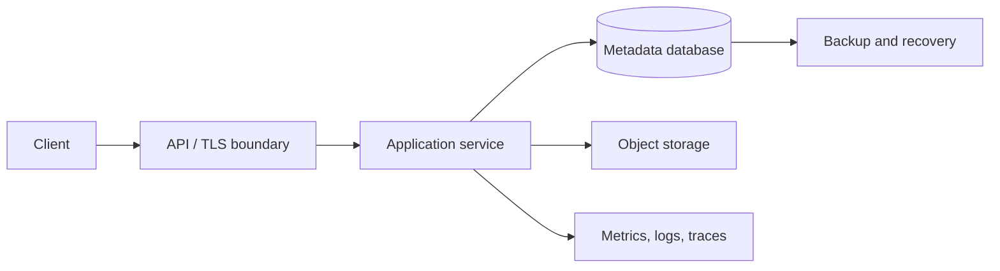
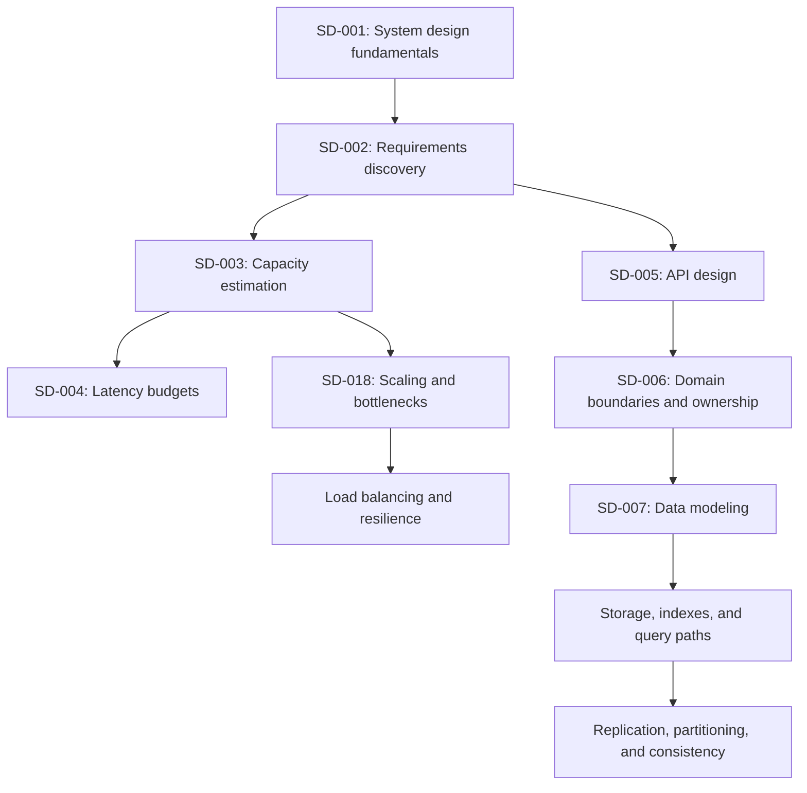

# DAY 1: System Design Fundamentals and Architectural Reasoning

**Progression level:** Level 1, Foundations and architectural reasoning  
**Concept ID:** SD-001  
**Prerequisites:** None  
**Status:** Lesson delivered. Exercises pending.

### 1. Why It Exists

System design decides how software components, data, and operational controls combine to satisfy a workload under explicit constraints. Local implementation correctness does not guarantee system-level correctness. A handler can be correct in isolation while the service fails under burst traffic; a database can be durable while a workflow loses an update; redundant replicas can all become unavailable through a shared dependency.

A design reconciles competing quality attributes: latency, throughput, availability, durability, consistency, security, operability, and cost. These attributes are not interchangeable. A synchronous dependency may improve freshness while increasing tail latency and reducing availability. Replication may improve read capacity and recovery options while introducing lag and failover complexity. Caching can reduce database load while creating invalidation and staleness problems.

The simplest implementation is often the right baseline, but only while it satisfies stated or measured requirements. Ignoring constraints creates accidental architecture: bottlenecks appear unexpectedly, failure domains remain coupled, and redesign becomes expensive after interfaces and data contracts harden.

The objective is not to maximize component count. It is to make the smallest set of architectural decisions that satisfies requirements and exposes remaining risks.

### 2. Core Idea

A system design begins with a bounded problem and explicit assumptions. Its core elements are:

- **Workload:** request and event types, read/write mix, payload sizes, concurrency, burstiness, and growth.
- **Requirements:** externally visible behavior and measurable quality attributes.
- **Architecture:** components, ownership boundaries, data flows, dependencies, and trust boundaries.
- **Constraints:** budget, team capability, deployment environment, compliance, existing systems, and timeline.
- **Failure model:** expected faults, their scope, and required behavior during and after them.
- **Tradeoffs:** what a decision improves, what it costs, and which assumptions make it valid.

Distinguish mechanism from requirement. A distributed cache is a mechanism. A requirement such as p99 latency below 100 ms at a defined load may justify it, but only after estimating the request path and identifying the bottleneck.

Specify observable contracts. “Highly available” is incomplete. “The read API must remain usable during one application-instance failure, with a monthly availability objective of 99.9%” is testable, although failure scope and measurement window still need agreement. “Fast” is incomplete. A latency objective needs a percentile, workload, and measurement boundary.

Architectural reasoning proceeds iteratively: establish requirements, model workload, sketch a baseline, identify bottlenecks and failure modes, compare alternatives, then validate assumptions with measurement or a prototype. This does not imply all uncertainty can be removed before implementation. It makes uncertainty visible.

### 3. Mental Model

Treat a system as a graph. Nodes represent components or stateful resources; directed edges represent calls, data movement, or control dependencies. Each node has capacity, latency, failure behavior, ownership, and operational cost. Each edge has a protocol, timeout, retry behavior, and security boundary.

For a synchronous request path, end-to-end latency is approximately the sum of sequential component and network latencies, plus queueing and processing. Parallel branches contribute according to the slowest branch on the critical path. A limited-capacity component can constrain the whole path, and a failed dependency can propagate failure to callers.

```text
Client -> API -> Application -> Database
                    |
                    +------> External service
```

If the application waits for both the database and external service, completion depends on both. If the external call is optional enrichment, the system might return a degraded response when that dependency is slow, provided the product contract permits it.

The graph model helps identify critical paths, shared dependencies, bottlenecks, and failure propagation. Its limitation is that a static graph hides time-dependent behavior such as queue growth, autoscaling delay, cache warm-up, correlated failures, and changing traffic distributions. Those require workload models, state-transition reasoning, and operational evidence.

### 4. Real-World Example

Consider an API that stores user-generated documents and serves them to clients.

**Documented facts:** HTTP defines request/response semantics, and databases document their transaction and durability guarantees. Take guarantees from the selected implementation's documentation rather than infer them from an architecture diagram. References: [RFC 9110, HTTP Semantics](https://www.rfc-editor.org/rfc/rfc9110) and [PostgreSQL transaction tutorial](https://www.postgresql.org/docs/current/tutorial-transactions.html).

**Established industry practice:** Begin with an API service, a transactional database, and object storage only if document size or access patterns justify separating blobs from metadata. Instrument request latency and errors before adding caches or replicas. Define the authoritative owner of each document and make write-success semantics explicit.

**Engineering inference for this example:** Suppose metadata is small, writes need uniqueness constraints, and traffic is moderate. A single relational database with a clear schema is a reasonable baseline. Store large binary payloads in object storage and keep references plus metadata in the database. If measured reads later saturate the database, inspect query plans and indexes before evaluating caching or read replicas. If traffic grows unevenly by tenant, model tenant skew before choosing a partition key.

These are choices for a hypothetical workload, not claims about a proprietary service. The correct architecture depends on actual requirements and measurements.

### 5. Low-Level Design (LLD)

Define component contracts and invariants before selecting infrastructure.

For the document API, an initial contract might include:

- CreateDocument(ownerID, metadata, contentRef) returns a stable document identifier.
- GetDocument(ownerID, documentID) returns only a document the caller is authorized to access.
- The database enforces uniqueness and required-field constraints.
- A successful create response means the metadata transaction committed and referenced content is available according to the API contract.
- Retries of a create operation must not accidentally create multiple logical documents when the client uses an idempotency key.

A minimal metadata table might contain document_id, owner_id, content_ref, created_at, and version. The primary key protects identifier uniqueness; an index on (owner_id, created_at) may support owner-scoped listing, subject to the actual query shape and plan. Indexes are hypotheses until validated against access patterns.

Important state transitions include upload initiated, content stored, metadata committed, and document visible. If content storage and metadata storage do not share a transaction, the workflow needs explicit recovery for orphaned content or dangling metadata. The API must not report success before its promised durability boundary.

Concurrency concerns include simultaneous updates, duplicate requests, authorization changes, and resource exhaustion. Use database constraints for invariants that must survive concurrent writers. Application-level check-then-insert logic alone is insufficient when requests can race. Bound request bodies, database connections, and downstream deadlines. Propagate cancellation and avoid leaking goroutines or open resources.

Failure cases include validation errors, authorization denial, database timeout, object-store timeout, duplicate idempotency key with a different payload, process termination between storage steps, and retry after an ambiguous timeout. Each case needs a defined observable result and recovery path.

### 6. High-Level Design (HLD)

A baseline architecture keeps the request path simple and ownership explicit.



The API boundary authenticates requests, enforces request limits, and routes traffic. The application layer owns document behavior and authorization. The database owns metadata invariants. Object storage owns blob persistence. Telemetry captures request outcomes and dependency timings.

A create request validates identity and metadata, stores or references content according to the upload protocol, commits metadata, and returns the documented result. A read request authorizes the owner, loads metadata, and obtains content from object storage or returns a controlled download reference. The exact ordering depends on whether content is uploaded directly by the client or proxied through the application.

Scale application instances horizontally when they are stateless and the database remains within its capacity envelope. Adding application replicas does not necessarily increase end-to-end capacity if requests still contend on one database or external dependency. A shared database is both a state boundary and a potential common failure domain. Backups are useful only if restoration has been tested and recovery objectives are achievable.

### 7. Realistic Go Code

This implementation demonstrates boundary discipline for a bounded HTTP endpoint: validate input, use context-aware storage, and map errors to stable HTTP behavior. It is an executable service skeleton, not a complete document platform.

```go
package main

import (
	"context"
	"encoding/json"
	"errors"
	"log"
	"net/http"
	"strings"
	"time"
)

var (
	ErrInvalidDocument = errors.New("invalid document")
	ErrNotFound        = errors.New("document not found")
)

type Document struct {
	ID    string
	Title string
}

type DocumentStore interface {
	Get(ctx context.Context, id string) (Document, error)
}

type API struct {
	store      DocumentStore
	getTimeout time.Duration
}

func NewAPI(store DocumentStore) *API {
	return &API{store: store, getTimeout: 800 * time.Millisecond}
}

func (a *API) ServeHTTP(w http.ResponseWriter, r *http.Request) {
	if r.Method != http.MethodGet {
		w.Header().Set("Allow", http.MethodGet)
		http.Error(w, "method not allowed", http.StatusMethodNotAllowed)
		return
	}

	id := strings.TrimSpace(r.URL.Query().Get("id"))
	if id == "" || len(id) > 128 {
		http.Error(w, ErrInvalidDocument.Error(), http.StatusBadRequest)
		return
	}

	ctx, cancel := context.WithTimeout(r.Context(), a.getTimeout)
	defer cancel()

	doc, err := a.store.Get(ctx, id)
	if err != nil {
		switch {
		case errors.Is(err, context.DeadlineExceeded):
			http.Error(w, "dependency timeout", http.StatusGatewayTimeout)
		case errors.Is(err, context.Canceled):
			return
		case errors.Is(err, ErrNotFound):
			http.Error(w, ErrNotFound.Error(), http.StatusNotFound)
		default:
			http.Error(w, "internal error", http.StatusInternalServerError)
		}
		return
	}

	w.Header().Set("Content-Type", "application/json")
	w.Header().Set("Cache-Control", "private, no-store")
	if err := json.NewEncoder(w).Encode(doc); err != nil {
		log.Printf("encode response: %v", err)
	}
}

func main() {
	log.Println("Provide a DocumentStore implementation before starting the HTTP server")
}
```

The example shows a context deadline and an interface boundary, but intentionally does not pretend an unimplemented store provides persistence. In a real server, construct a concrete store, configure http.Server read/write/idle timeouts, close dependencies on shutdown, and instrument the handler. Avoid logging document contents or credentials. Add an explicit authorization context and a stable error schema before production use. JSON field tags are omitted here, so the default encoder uses exported Go field names; define explicit tags when the API's wire schema is fixed.

### 8. Example Usage

A request to GET /documents?id=doc-123 should produce a JSON document and status 200 when the store finds an authorized record. An empty identifier or identifier longer than the contract allows produces 400. A missing document produces 404. A store deadline produces 504, while an unexpected dependency error produces a generic 500 without leaking internal details.

A handler test should inject a fake DocumentStore and verify each mapping. A fake returning Document{ID: "doc-123", Title: "Design"} should yield Content-Type application/json and a decodable response body. A fake returning ErrNotFound should yield 404. A fake that waits for ctx.Done() should respect cancellation and cause a timeout response when the deadline expires. These tests validate the API contract independently of a real database.

Test bounded JSON decoding separately for oversized bodies, malformed JSON, trailing JSON values, and a valid single JSON value before wiring it into a write endpoint. Do not infer that the complete platform is correct from handler-level tests.

### 9. Production Considerations

**Scalability:** Establish traffic shape and resource limits before scaling. Measure CPU, memory, connection pools, database saturation, object-store throughput, and tenant skew. Application replicas help only where application capacity is limiting.

**Latency:** Track p50, p95, and p99 by route and dependency. Use deadlines that fit within the caller's latency budget. Sequential downstream calls add latency; parallel calls add coordination and partial-result complexity.

**Availability and recovery:** Identify shared dependencies and correlated failure domains. Define RPO and RTO, validate backup restoration, and rehearse recovery. A successful backup job is not proof of recoverability.

**Consistency and concurrency:** Define the durability point for writes, read-after-write expectations, update conflict semantics, and idempotency behavior. Use database constraints and conditional updates to enforce invariants under concurrent requests.

**Security:** Authenticate callers, authorize every object access, constrain payload sizes, validate input, protect credentials, and use TLS at trust boundaries. Avoid leaking database errors or sensitive identifiers in logs.

**Observability:** Record request rate, errors, latency, saturation, and dependency outcomes. Correlate traces across boundaries. Keep metric cardinality bounded and redact sensitive data.

**Resource management:** Bound concurrent work, connection pools, body sizes, and request deadlines. Propagate cancellation. Drain traffic and close resources during graceful shutdown.

**Cost and deployment:** Model storage growth, request volume, egress, replication, and telemetry cost. Deploy schema changes compatibly, use staged rollout for risky changes, and retain a rollback path. Controls should follow demonstrated risk rather than be added indiscriminately.

### 10. Tradeoffs

| Choice | Benefits | Costs and constraints | Appropriate when |
|---|---|---|---|
| Single application and relational database | Simple ownership, transactions, operations | Database may become a bottleneck or shared failure domain | Workload and availability fit one primary data system |
| Split metadata and object storage | Efficient blob handling and independent scaling | Cross-system lifecycle and orphan cleanup | Payloads are large or blob delivery scales differently |
| Add a cache | Lower read latency and backend load | Staleness, invalidation, stampedes, extra failure modes | Measurements show repeated reads and acceptable freshness |
| Add read replicas | Read capacity and some failover options | Replication lag, routing complexity, failover semantics | Read-heavy workload tolerates the consistency model |
| Split into services | Independent ownership and deployment boundaries | Network calls, distributed workflows, operational overhead | Team or scaling boundaries justify added complexity |

The correct choice depends on workload. Prefer the simplest architecture that satisfies explicit requirements and has a credible growth and recovery path. Change it when evidence shows assumptions no longer hold.

### 11. Connection to Previous Lessons

No previous lessons exist. Day 1 establishes the curriculum's foundational assumptions: architecture is evaluated against explicit requirements; components have capacity and failure behavior; data ownership and invariants must be clear; and every significant decision has costs as well as benefits. The learner is assumed to have general backend, networking, database, concurrency, and Go experience, but no prior curriculum concept is marked complete.

### 12. What Comes Next

**SD-002: Requirements discovery and specification.** It follows because architectural choices cannot be evaluated until functional behavior, measurable quality attributes, constraints, assumptions, and out-of-scope cases are explicit. The next lesson will turn an ambiguous product prompt into a testable system specification. It is not taught here.

### 13. Mini Exercise

A team proposes a document API with “high availability,” “fast reads,” and “large scale” as its only requirements.

Write a concise requirements brief that defines at least three functional requirements, three measurable non-functional requirements, two constraints, and three explicit assumptions. For every non-functional requirement, specify the measurement boundary and workload condition.

**Acceptance criteria:** Each requirement is testable; availability and latency include a defined scope; assumptions are distinguished from confirmed facts; and no infrastructure technology is selected merely because it is familiar.

### Key Takeaways

- System design optimizes competing quality attributes under explicit constraints.
- Requirements and workload assumptions should precede infrastructure choices.
- A request/data-flow graph reveals critical paths, bottlenecks, shared dependencies, and failure propagation.
- Data ownership and invariants must remain correct under concurrency and partial failure.
- Measure the bottleneck before introducing distributed complexity.
- Lesson delivery is not evidence of exercise completion or mastery.

### Concept Map



### Exercise

Design a production-oriented document service for 2,000 average requests/second, a 5x peak multiplier, 80% reads, 20% writes, and projected 10 TB of blob storage after one year. Treat these as exercise inputs, not measured facts.

Deliverables:
1. A one-page requirements and assumptions document.
2. A capacity estimate for peak requests/second, read/write rates, storage growth, and first-pass bandwidth with stated payload assumptions.
3. An HLD diagram showing API, metadata storage, blob storage, and observability boundaries.
4. An LLD describing document identity, ownership, write-state transitions, idempotency, and orphan cleanup.
5. A failure table covering database unavailability, object-store timeout, process crash between write steps, and duplicate client retries.
6. A tradeoff record comparing a single relational store for metadata with a design that also uses object storage.

**Acceptance criteria:** Estimates show assumptions and units; the design identifies authoritative owners of metadata and content; each failure case has a client-visible outcome and recovery path; and known requirements are distinguished from design hypotheses. Do not implement replication, sharding, or caching unless requirements and estimates justify them.

### Progress

- **Day:** 1
- **Progression level:** Level 1, Foundations and architectural reasoning
- **Current concept:** SD-001, System design fundamentals and architectural reasoning
- **Lesson path:** system-design/lessons/day-01-system-design-fundamentals.md
- **Prerequisites satisfied:** Yes, SD-001 has no prerequisites.
- **Exercise status:** Mini exercise pending; substantial exercise pending. No learner submission was available for review.
- **Concepts covered:** SD-001 only.
- **Next concept:** SD-002, Requirements discovery and specification. Its prerequisite SD-001 is covered.
- **Repository update status:** README is in the initial commit. Curriculum, progress, and this lesson are in the follow-up commit; final branch and file verification is required.

### Most Important Mental Model

**Design the smallest system that satisfies explicit workload and quality constraints, then validate its bottlenecks, invariants, and failure behavior with evidence.**
