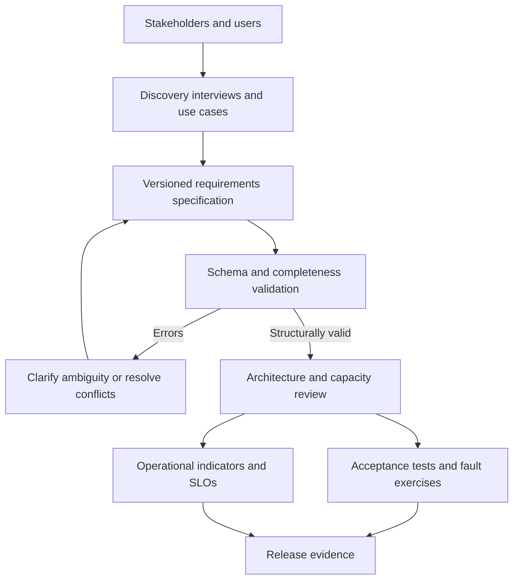
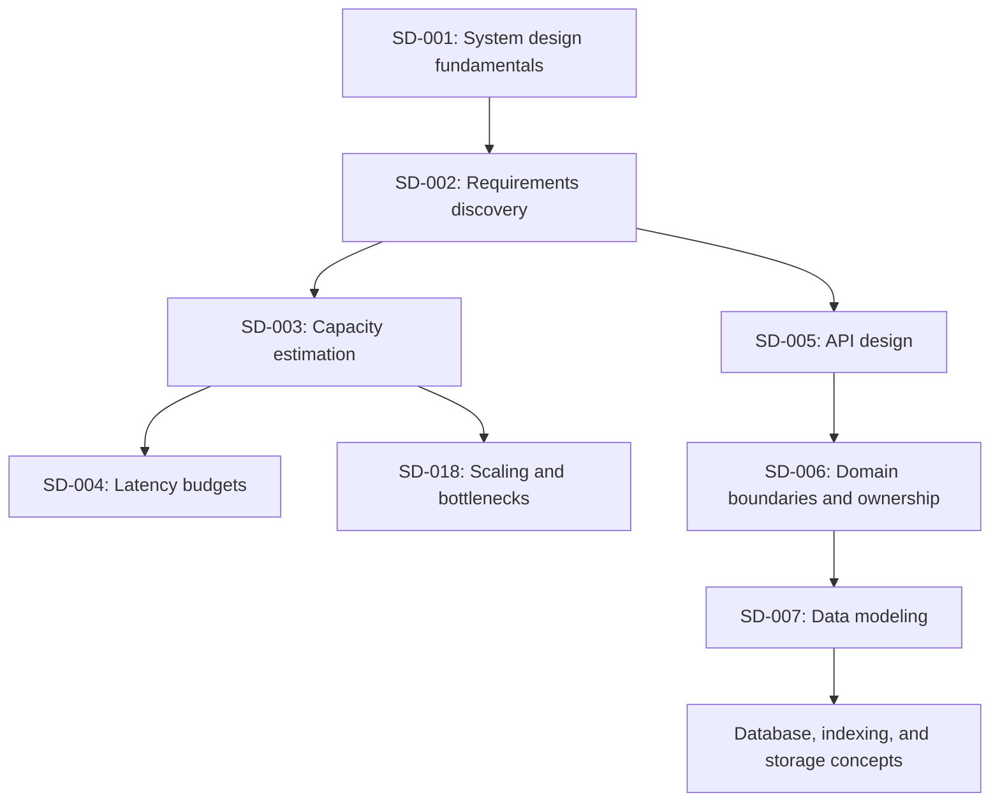

# DAY 2: Requirements Discovery and Specification

**Progression level:** Level 1, Foundations and architectural reasoning  
**Concept ID:** SD-002  
**Prerequisites:** SD-001, System design fundamentals and architectural reasoning, covered  
**Status:** Lesson delivered. Exercises pending.

### 1. Why It Exists

System design starts with a problem, not a technology choice. Requests such as “make the API fast,” “support high availability,” or “scale to millions of users” do not define a testable contract. They omit the workload, measurement boundary, failure scope, and acceptable behavior. Two engineers can satisfy those phrases with incompatible systems and both claim success.

Ambiguous requirements propagate into every later decision. Capacity estimates depend on traffic shape and payload sizes. Database choices depend on access patterns, invariants, and durability expectations. Caching depends on freshness requirements. Replication and failover depend on consistency and recovery objectives. If these inputs remain implicit, architecture reviews become debates over unstated assumptions, and production incidents reveal that stakeholders meant different things by “available” or “successful.”

A feature list is necessary but insufficient. “Users can upload documents” says nothing about duplicate retries, partial uploads, authorization, maximum size, retention, or whether an acknowledged upload must survive an availability-zone failure. A non-functional adjective is also insufficient until it has a measurable target and a defined test condition.

The goal is not to eliminate all uncertainty before implementation. It is to separate confirmed requirements from assumptions, expose conflicts, establish acceptance criteria, and record open questions so design decisions can be evaluated against a shared contract.

### 2. Core Idea

A requirements specification describes externally observable behavior and the conditions under which that behavior must hold. It should remain largely independent of the implementation. “The service must return a successful read within 200 ms at p99 under the defined peak workload” is a requirement. “Put Redis in front of PostgreSQL” is a proposed solution that may or may not satisfy it.

Classify statements explicitly:

- **Functional requirement:** behavior the system must provide to an actor, including normal flows, authorization, invalid input, retries, and relevant failure behavior.
- **Quality attribute or non-functional requirement:** a measurable property such as latency, availability, durability, throughput, recoverability, security, or operability. It needs a metric, target, scope, workload or failure condition, and measurement window.
- **Constraint:** a binding boundary imposed on the solution, such as a mandated protocol, data residency rule, existing platform, budget ceiling, or delivery deadline.
- **Assumption:** a provisional belief used for planning but not yet confirmed. Record how and when it will be validated, plus the design decision that depends on it.
- **Out of scope:** behavior explicitly excluded from the current delivery. This prevents accidental expansion of the contract.
- **Acceptance criterion:** an observable condition that demonstrates a requirement has been met. It should map to a test, measurement, review, or operational exercise.

A useful quality-objective tuple is:

`(metric, comparator, target, scope, workload/failure condition, measurement window)`

For example: “For successful GET /v1/documents requests, p99 server-side latency must be at most 200 ms while total traffic is 10,000 requests/second with an 80/20 read/write mix, measured over rolling five-minute intervals.” This statement still requires agreement on the percentile calculation, clock boundaries, and treatment of client disconnects, but it is much more actionable than “reads should be fast.”

Availability also needs a contract. Define which requests count as eligible, which outcomes count as successful, the measurement window, and the failure scope. A percentage without a numerator and denominator is easy to misinterpret. Durability needs an acknowledgement boundary and a failure model. “No acknowledged writes lost” is meaningful only when the system specifies which acknowledged writes, under which failures, and how the claim will be tested.

Separate a **requirement** from an **SLO** and from an **implementation decision**. A requirement expresses stakeholder need. An SLO is an operationally measurable target for a service indicator, often with a defined compliance window and error budget. An implementation decision selects mechanisms intended to satisfy requirements and SLOs. These artifacts should trace to one another, but they are not interchangeable. The Google SRE guidance on service-level objectives discusses choosing indicators and objectives around user-visible service behavior: https://sre.google/sre-book/service-level-objectives/.

A practical discovery sequence is:

1. Identify actors, primary use cases, and business outcomes.
2. Specify successful flows, invalid requests, authorization boundaries, and important failure behavior.
3. Establish the workload envelope: average and peak rates, read/write mix, concurrency, payload sizes, burst duration, growth, and tenant skew.
4. Define quality objectives with measurement boundaries and explicit conditions.
5. Record constraints, assumptions, out-of-scope behavior, and unresolved questions.
6. Define acceptance criteria and map each requirement to evidence.
7. Resolve conflicts by making priorities and consequences explicit, then baseline the specification.

Prioritize requirements instead of treating every request as equally binding. Distinguish launch blockers from desirable properties. If a stakeholder asks for both globally linearizable writes and very low cross-region write latency during a network partition, document the conflict and the consequences of each option. Do not hide a product decision inside an infrastructure choice.

### 3. Mental Model

Treat a requirement as a contract tuple:

`R = (actor, stimulus, behavior, context, measure, threshold, evidence)`

- **Actor and stimulus:** who initiates what action.
- **Behavior:** what the system promises, including relevant error and failure outcomes.
- **Context:** load, tenant, data size, dependency state, or failure scenario.
- **Measure and threshold:** what is observed and what value is acceptable.
- **Evidence:** the test, benchmark, review, or operational measurement that proves compliance.

Then maintain a traceability graph:

`stakeholder need -> requirement -> acceptance evidence -> design decision -> telemetry`

This graph prevents a common failure mode: a component is deployed because it is familiar, but nobody can explain which requirement justified it or which signal proves it is working. It also makes change impact visible. If the read-latency objective changes, identify the affected capacity model, storage access patterns, tests, and operational dashboards.

The model is not a substitute for judgment. A requirement can be measurable and still be wrong, incomplete, mutually incompatible with another requirement, or too expensive for its value. Qualitative concerns such as operator usability and abuse resistance may require structured review in addition to numerical thresholds. Requirements also evolve as real workload data replaces assumptions. Version the specification and record why changes were accepted.

### 4. Real-World Example

Consider the document API introduced in Day 1. The following numbers are **hypothetical exercise inputs**, not facts about any existing product: 2,000 average requests/second, a 10,000 requests/second peak, an 80% read and 20% write mix, and 10 TB of projected blob storage after one year.

**Documented facts:** HTTP defines semantics for methods, status codes, and message handling. An API contract should use those semantics precisely rather than invent ambiguous success behavior. See RFC 9110, HTTP Semantics: https://www.rfc-editor.org/rfc/rfc9110. The specific behavior of a document service remains a product decision.

**Established industry practice:** Gather user journeys and failure cases, quantify the workload, define service-level objectives, state data-retention and recovery expectations, and make acceptance criteria reviewable. Keep assumptions visible. Do not treat an architecture proposal as a confirmed requirement.

**Engineering inference for this example:** A first specification might require authenticated users to create, retrieve, and list only their own documents; reject invalid metadata and unauthorized access; and make create retries safe through a client-supplied idempotency key. It might set a p99 read-latency target at peak load, define availability over a rolling 30-day window, and require zero loss of acknowledged metadata writes during a tested single-availability-zone failure. These targets need stakeholder approval and feasibility testing before they become a delivery commitment.

A discovery review should ask questions such as: Does “upload success” mean the blob is durable, metadata is committed, or both? Are reads allowed to return a recently deleted document? What is the maximum object size? Can clients retry after an ambiguous timeout? Is the latency objective measured at the server or end to end? Does the availability target include planned maintenance and client errors? How long must deleted content remain recoverable?

Those answers change architecture. Direct-to-object-storage uploads may reduce application bandwidth but require a defined completion protocol. Idempotency may require durable request records and payload-conflict behavior. A strict acknowledged-write durability requirement may affect storage configuration and failover procedures. The specification makes these consequences discussable before implementation.

### 5. Low-Level Design (LLD)

Keep the specification structured enough for review and lightweight validation. A practical document contains metadata, functional requirements, quality objectives, constraints, assumptions, exclusions, owners, and revision history. Each item has a stable identifier so tests, design documents, and telemetry can refer to it.

A functional requirement should contain an actor, behavior, and acceptance criterion. A quality objective should contain a metric, comparator, target, unit, scope, workload or failure condition, and measurement window. Latency objectives additionally identify the percentile or other aggregation method. Constraints and assumptions should be distinguishable by type and have an owner or validation action in a real project.

The accompanying Go implementation validates completeness and basic consistency. It deliberately does not attempt to infer whether a target is achievable, whether stakeholders agree, or whether two objectives conflict. Those require engineering analysis and review.

Important invariants for the specification validator are:

- Every requirement identifier is non-empty and unique across all categories.
- Functional requirements have an actor, behavior, and acceptance criterion.
- Quality objectives have a metric, comparator, finite non-negative target, unit, scope, workload or failure condition, and measurement window.
- Latency objectives state a percentile.
- An invalid specification produces actionable errors and cannot be silently treated as approved.

Validation should be deterministic and side-effect free. It should return all detectable errors in one pass rather than forcing a reviewer to fix them one at a time. The caller decides whether errors block a pull request, a design review, or a release. A successful validation result means only that required fields are present, not that the architecture satisfies the objectives.

### 6. High-Level Design (HLD)

A lightweight requirements workflow can live alongside the service code and architecture artifacts:



The specification is the boundary between product intent and technical design. Engineering reviews feasibility, dependencies, and failure behavior. Product and business owners resolve priority conflicts. Security and compliance stakeholders validate relevant constraints. Test and operations owners confirm that the contract can be verified after deployment.

For the document API, the request flow is not selected until the contract defines authentication, ownership, write acknowledgement, retry behavior, and latency measurement. Once these are agreed, the team can compare direct uploads versus proxied uploads, database transaction boundaries, object lifecycle handling, and failure recovery. Acceptance tests exercise observable behavior; telemetry measures the same indicators in production.

Keep requirements and implementation details linked but separate. A design decision record should reference the requirement IDs it addresses and document rejected alternatives. If an objective changes, review affected decisions and tests. If production telemetry repeatedly violates an objective, determine whether the implementation is deficient, the workload assumption was wrong, or the objective itself needs renegotiation. Do not silently weaken the target to make a dashboard green.

### 7. Realistic Go Code

The following single-file Go program implements a small specification linter using only the standard library. It checks structural completeness and identifier uniqueness, and it emits field-specific validation errors. It is suitable as a CI gate for a versioned requirements document after the specification is decoded into these types.

```go
package main

import (
	"fmt"
	"math"
	"os"
	"strings"
)

type Comparator string

const (
	AtMost  Comparator = "<="
	AtLeast Comparator = ">="
)

type FunctionalRequirement struct {
	ID         string
	Actor      string
	Behavior   string
	Acceptance string
}

type Objective struct {
	ID         string
	Metric     string
	Comparator Comparator
	Target     float64
	Unit       string
	Scope      string
	Workload   string
	Window     string
	Percentile string
}

type TextItem struct {
	ID        string
	Statement string
}

type Spec struct {
	Name        string
	Functional  []FunctionalRequirement
	Objectives  []Objective
	Constraints []TextItem
	Assumptions []TextItem
	OutOfScope  []TextItem
}

type ValidationError struct {
	Path    string
	Message string
}

func (e ValidationError) Error() string {
	return fmt.Sprintf("%s: %s", e.Path, e.Message)
}

func (s Spec) Validate() []ValidationError {
	var problems []ValidationError
	add := func(path, message string) {
		problems = append(problems, ValidationError{Path: path, Message: message})
	}
	require := func(path, field, value string) {
		if strings.TrimSpace(value) == "" {
			add(path+"."+field, "must not be empty")
		}
	}

	require("spec", "name", s.Name)
	if len(s.Functional) == 0 {
		add("functional", "at least one functional requirement is required")
	}
	if len(s.Objectives) == 0 {
		add("objectives", "at least one quality objective is required")
	}

	seen := make(map[string]string)
	checkID := func(path, id string) {
		id = strings.TrimSpace(id)
		if id == "" {
			add(path+".id", "must not be empty")
			return
		}
		if previous, ok := seen[id]; ok {
			add(path+".id", fmt.Sprintf("duplicates identifier used at %s", previous))
			return
		}
		seen[id] = path
	}

	for i, r := range s.Functional {
		path := fmt.Sprintf("functional[%d]", i)
		checkID(path, r.ID)
		require(path, "actor", r.Actor)
		require(path, "behavior", r.Behavior)
		require(path, "acceptance", r.Acceptance)
	}

	for i, o := range s.Objectives {
		path := fmt.Sprintf("objectives[%d]", i)
		checkID(path, o.ID)
		require(path, "metric", o.Metric)
		require(path, "unit", o.Unit)
		require(path, "scope", o.Scope)
		require(path, "workload", o.Workload)
		require(path, "window", o.Window)

		if o.Comparator != AtMost && o.Comparator != AtLeast {
			add(path+".comparator", "must be <= or >=")
		}
		if math.IsNaN(o.Target) || math.IsInf(o.Target, 0) || o.Target < 0 {
			add(path+".target", "must be finite and non-negative")
		}
		if strings.Contains(strings.ToLower(o.Metric), "latency") &&
			strings.TrimSpace(o.Percentile) == "" {
			add(path+".percentile", "latency objectives must specify a percentile")
		}
	}

	validateTextItems := func(category string, items []TextItem) {
		for i, item := range items {
			path := fmt.Sprintf("%s[%d]", category, i)
			checkID(path, item.ID)
			require(path, "statement", item.Statement)
		}
	}
	validateTextItems("constraints", s.Constraints)
	validateTextItems("assumptions", s.Assumptions)
	validateTextItems("out_of_scope", s.OutOfScope)

	return problems
}

func exampleSpec() Spec {
	return Spec{
		Name: "Document API v1",
		Functional: []FunctionalRequirement{
			{
				ID: "FR-001", Actor: "authenticated owner",
				Behavior: "create a document with validated metadata",
				Acceptance: "valid input returns a stable document ID; invalid input returns 400",
			},
			{
				ID: "FR-002", Actor: "authenticated owner",
				Behavior: "retrieve a document owned by the caller",
				Acceptance: "authorized existing document returns 200; missing document returns 404",
			},
			{
				ID: "FR-003", Actor: "client retrying a create",
				Behavior: "reuse the same idempotency key for the same logical request",
				Acceptance: "a retry does not create a second document; key reuse with a different payload is rejected",
			},
		},
		Objectives: []Objective{
			{
				ID: "NFR-001", Metric: "request_availability",
				Comparator: AtLeast, Target: 99.9, Unit: "percent",
				Scope: "eligible public API requests, with client-caused 4xx responses excluded",
				Workload: "2,000 average requests/second and 10,000 peak requests/second",
				Window: "rolling 30 days",
			},
			{
				ID: "NFR-002", Metric: "read_latency",
				Comparator: AtMost, Target: 200, Unit: "milliseconds",
				Scope: "successful GET /v1/documents requests measured at the service boundary",
				Workload: "10,000 total requests/second with an 80 percent read mix",
				Window: "rolling five-minute intervals",
				Percentile: "p99",
			},
			{
				ID: "NFR-003", Metric: "acknowledged_write_loss",
				Comparator: AtMost, Target: 0, Unit: "records",
				Scope: "metadata writes acknowledged before the injected failure",
				Workload: "peak traffic during a single-availability-zone loss",
				Window: "one failover and recovery exercise",
			},
		},
		Constraints: []TextItem{
			{ID: "C-001", Statement: "Public API clients use HTTPS and JSON"},
		},
		Assumptions: []TextItem{
			{ID: "A-001", Statement: "The stated peak workload is representative of launch traffic"},
		},
		OutOfScope: []TextItem{
			{ID: "X-001", Statement: "Full-text search is not part of the initial release"},
		},
	}
}

func main() {
	spec := exampleSpec()
	problems := spec.Validate()
	if len(problems) != 0 {
		for _, problem := range problems {
			fmt.Fprintln(os.Stderr, problem)
		}
		os.Exit(1)
	}

	fmt.Printf(
		"valid specification: %s (%d functional requirements, %d objectives)\n",
		spec.Name, len(spec.Functional), len(spec.Objectives),
	)
}
```

The code checks completeness, not truth. A structurally valid 99.999% availability objective may be incompatible with budget, architecture, or operational maturity. The validator also cannot determine whether the selected latency percentile is computed consistently across services. Those questions need a review process and evidence. In production, decode a versioned YAML or JSON schema with strict unknown-field handling, preserve provenance and ownership, and make CI failures actionable.

### 8. Example Usage

Save the implementation as `main.go`, then run:

```bash
go run .
```

Expected output:

```text
valid specification: Document API v1 (3 functional requirements, 3 objectives)
```

Add the following tests as `main_test.go` in the same package:

```go
package main

import "testing"

func TestExampleSpecIsStructurallyValid(t *testing.T) {
	if problems := exampleSpec().Validate(); len(problems) != 0 {
		t.Fatalf("unexpected validation errors: %v", problems)
	}
}

func TestLatencyObjectiveRequiresPercentile(t *testing.T) {
	spec := exampleSpec()
	spec.Objectives[1].Percentile = ""

	problems := spec.Validate()
	if len(problems) == 0 {
		t.Fatal("expected missing-percentile validation error")
	}
}

func TestIdentifiersMustBeUniqueAcrossCategories(t *testing.T) {
	spec := exampleSpec()
	spec.Objectives[0].ID = spec.Functional[0].ID

	problems := spec.Validate()
	if len(problems) == 0 {
		t.Fatal("expected duplicate-identifier validation error")
	}
}
```

Run `go test ./...`. The valid fixture should pass. Removing the latency percentile or duplicating an identifier should fail validation. Also test empty fields, unsupported comparators, NaN and infinite targets, negative targets, and an empty specification.

The next engineering step would be to parse a checked-in specification file and validate it in CI. Keep that integration separate from the linter's core rules so the validation logic can be tested without repository or network access. Do not mark the requirements approved solely because the program exits successfully.

### 9. Production Considerations

**Stakeholder alignment:** Assign an owner to each requirement and record who can resolve conflicts. Capture the rationale for priorities. An undocumented assumption tends to become an accidental promise.

**Workload realism:** Define averages, peaks, burst durations, read/write mix, payload distribution, concurrency, growth, and tenant skew. A single requests-per-second number is not a complete capacity model. Mark estimated values as assumptions until measurements exist.

**Measurement boundaries:** State whether latency is client-observed or server-side, how timeouts and errors count, how percentiles are aggregated, and which traffic is excluded. Keep production telemetry aligned with the acceptance-test definition.

**Availability and durability:** Specify eligible requests, successful outcomes, measurement windows, acknowledgement semantics, and failure scenarios. Validate durability with fault injection and recovery exercises rather than inferring it from a replica count.

**Security and privacy:** Include authentication, authorization, tenant isolation, data classification, retention, deletion, auditability, and abuse cases. Avoid putting secrets or sensitive production data into requirement examples and test fixtures.

**Change management:** Version the specification. Changes to a target should trigger impact analysis for architecture decisions, tests, dashboards, alerts, and cost estimates. Preserve the previous baseline and the reason for changing it.

**Observability:** Every operational objective needs a source of evidence, an owner, and a response when it is violated. A metric without a decision or action attached may not be operationally useful.

**Feasibility and cost:** Estimate the cost of satisfying the strictest requirements. A tighter latency objective or longer retention period can change infrastructure and staffing costs. Surface the marginal cost and user value before approval.

**Automation boundaries:** A linter can enforce required fields, unique identifiers, and basic syntax. It cannot decide whether a requirement is valuable, realistic, secure, or internally consistent without richer domain-specific rules and human review.

### 10. Tradeoffs

| Approach | Benefits | Costs and limitations | Appropriate when |
|---|---|---|---|
| Informal notes and discussion | Fast to start; low ceremony | Ambiguity, weak traceability, difficult change impact | Small, low-risk prototypes with short lifetimes |
| Structured, versioned specification | Reviewable, diffable, traceable to tests and decisions | Requires ownership and maintenance discipline | Production systems, multiple teams, or evolving contracts |
| Fully schema-validated specification | Consistent fields, automated checks, CI integration | Can encourage false confidence; schema changes need care | Repeated design workflows with stable conventions |
| Numeric objectives for every quality | Enables measurement and feasibility analysis | Some qualities resist simple scalar targets; metrics can be gamed | Latency, throughput, availability, retention, and bounded recovery goals |
| Qualitative review for selected properties | Captures usability, abuse resistance, and complex security concerns | Harder to automate and compare | Properties needing threat modeling, expert review, or scenario analysis |

Use the least formal process that still makes the contract clear and auditable. Formality should increase with system risk, number of stakeholders, regulatory exposure, and cost of changing an incorrect assumption. Do not automate subjective approval merely because the specification is stored as YAML.

### 11. Connection to Previous Lessons

Day 1 established that architecture is a graph of components, data flows, constraints, and failure behavior, and that complexity should be justified by requirements. Day 2 turns that principle into a concrete discovery and specification process.

The document API example carries forward the same domain, but this lesson does not teach storage, caching, replication, or capacity estimation. It defines the information those later decisions require. The next lesson depends on the workload envelope and measurable behavior recorded here. No learner exercise submission has been observed, so no additional mastery claim is made.

### 12. What Comes Next

**SD-003: Capacity Estimation and Workload Modeling**, Level 1. SD-002 is now covered, so SD-003 is eligible. Capacity estimates depend on an explicit workload: average and peak request rates, operation mix, payload sizes, concurrency, burst duration, and growth assumptions. The next lesson will convert those inputs into first-pass compute, bandwidth, storage, and concurrency estimates. It will not teach capacity estimation in this lesson.

### 13. Mini Exercise

A product brief says: “Build a highly available document API that is fast, secure, and can scale.”

Rewrite it as a one-page specification for an initial release. Include at least three functional requirements, three measurable quality objectives, two constraints, three assumptions with validation plans, and two explicit out-of-scope items.

**Acceptance criteria:**
- Every functional requirement has an actor, behavior, and observable acceptance criterion.
- Every quality objective states a metric, target, unit, scope, workload or failure condition, and measurement window.
- Latency includes a percentile and measurement boundary.
- Assumptions are explicitly unconfirmed and include a validation action.
- The document distinguishes user needs from implementation proposals and records at least two open questions.

### Key Takeaways

- Requirements describe observable behavior and quality targets, not preferred technologies.
- Functional behavior, quality objectives, constraints, assumptions, and exclusions are different artifact types.
- A quality target needs a metric, threshold, scope, workload or failure condition, and measurement window.
- Acceptance evidence and operational telemetry should trace back to the same contract.
- Structured validation catches omissions but cannot prove feasibility or stakeholder agreement.
- Lesson delivery is not evidence that either exercise has been completed.

### Concept Map



### Exercise

Produce a reviewable requirements package for the hypothetical document API.

**Inputs:** 2,000 average requests/second, a 5x peak multiplier, 80% reads and 20% writes, and 10 TB of projected blob storage after one year. These are exercise assumptions, not observed production measurements.

**Deliverables:**
1. A versioned requirements document containing functional behavior, quality objectives, constraints, assumptions, exclusions, open questions, and named stakeholder roles.
2. A workload table defining average and peak traffic, read/write mix, payload-size assumptions, burst duration, and growth.
3. An acceptance matrix mapping every requirement ID to a test, benchmark, review, or fault exercise.
4. A traceability table linking each proposed architectural decision to the requirement IDs it addresses.
5. A risk register identifying at least five unresolved questions, their impact, owner, and resolution plan.
6. A short review record documenting conflicting requirements or tradeoffs and the decision owner.

**Acceptance criteria:** Every requirement is uniquely identified; assumptions are separated from confirmed facts; quality targets are measurable and include their scope and conditions; acceptance evidence is specific; and no technology choice is presented as a requirement without justification. Do not implement the system or perform the capacity calculations yet, those belong to later concepts.

### Progress

- **Day number:** 2
- **Progression level:** Level 1, Foundations and architectural reasoning
- **Current concept:** SD-002, Requirements discovery and specification
- **Lesson path:** `system-design/lessons/day-02-requirements-discovery-and-specification.md`
- **Prerequisites satisfied:** Yes, SD-001 is covered in Day 1.
- **Exercise status:** Mini exercise pending; substantial exercise pending. No learner submission was available for review.
- **Concepts covered:** SD-001 and SD-002.
- **Next concept:** SD-003, Capacity estimation and workload modeling. Its prerequisite SD-002 is covered. SD-005 is also eligible after SD-002, but SD-003 is earlier in the curriculum order.
- **Repository update status:** The Day 2 lesson, curriculum status changes, and progress tracker are included in the same curriculum commit.

### Most Important Mental Model

**A requirement is useful only when the intended behavior, operating conditions, acceptable threshold, and evidence of success are explicit.**
