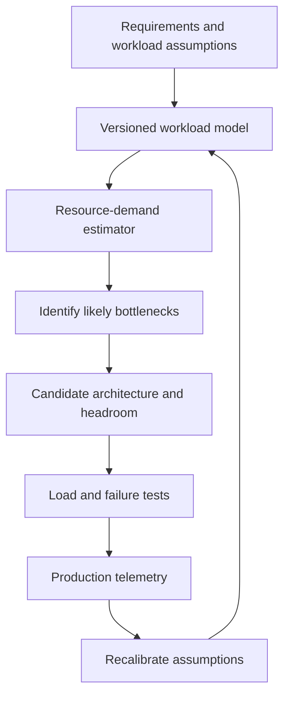
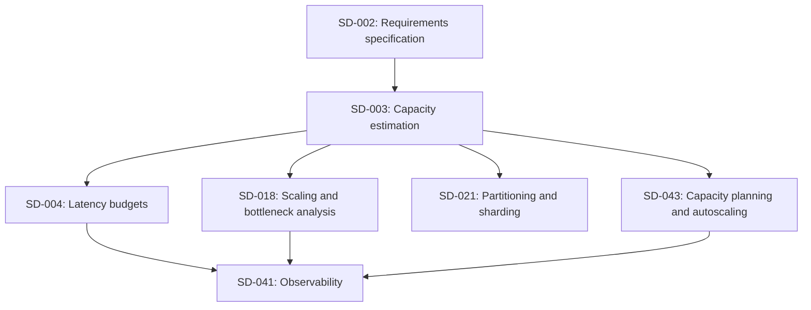

# DAY 3: Capacity Estimation and Workload Modeling

**Progression level:** Level 1, Foundations and architectural reasoning  
**Concept ID:** SD-003  
**Prerequisites:** SD-002, Requirements discovery and specification  
**Status:** Lesson delivered. Exercises pending.

### 1. Why It Exists

A design that works at low traffic can fail when CPU, memory, database connections, storage IOPS, network bandwidth, or a downstream service saturates. Capacity estimation makes these limits visible before deployment and helps establish a defensible starting point for load tests, infrastructure budgets, and scaling decisions.

Request rate alone is not a capacity model. Two services at 10,000 requests/second may have radically different resource demand if one serves small cache hits and the other performs multiple database writes and returns large payloads. Average traffic also hides bursts, expensive operation classes, tenant skew, and retry amplification.

The objective is not to predict an exact server count. It is to make assumptions explicit, calculate first-order resource demand, identify sensitive variables, and validate the result with measurements. Ignoring capacity can create growing queues, tail-latency spikes, exhausted connection pools, storage overruns, expensive overprovisioning, or a service that fails when one availability zone is lost.

### 2. Core Idea

A workload model defines what the system processes and under which conditions. Record at least average and peak arrival rates, peak duration and ramp, operation mix, payload sizes, CPU time per operation, latency, concurrency, storage growth, retention, and failure scenarios. Split materially different request classes instead of hiding their costs in one average.

Let average arrival rate be (R_a), peak multiplier (P), and read fraction (f_r):

[
R_p=R_aP,quad R_{read,p}=R_pf_r,quad R_{write,p}=R_p(1-f_r)
]

This assumes the operation mix stays constant at peak. Validate that assumption for batch jobs, launches, and other skewed workloads.

For average request and response sizes (B_{req}) and (B_{resp}):

[
Ingress_{B/s}approx R_pB_{req},quad Egress_{B/s}approx R_pB_{resp}
]

Multiply bytes/second by eight to get bits/second. These are application payload estimates, excluding protocol overhead, TLS, retransmissions, replication, and cross-zone traffic.

Little's Law gives (L=lambda W) for a stable system, where (L) is average work in the system, (lambda) is throughput, and (W) is mean time in the system. A rough in-flight concurrency estimate is:

[
Concurrencyapprox Throughput	imes MeanLatencySeconds
]

Use a mean latency that matches the throughput and measurement boundary. Substituting p99 does not yield Little's Law's average concurrency. If queues grow without bound, steady-state assumptions do not hold.

If each request consumes (C_{ms}) milliseconds of CPU and target utilization is (U):

[
Coresapprox rac{R_p(C_{ms}/1000)}{U}
]

This is a first-order estimate. It omits runtime overhead, garbage collection, background work, service-time variance, and failure reserve unless explicitly modeled.

For average write rate (R_w), logical bytes per write (B_w), and horizon (T) seconds:

[
LogicalGrowthBytesapprox R_wB_wT
]

Logical payload growth excludes indexes, replicas, backups, metadata, compaction, compression effects, retention overlap, and delayed reclamation.

Keep four categories separate: measured or approved facts, provisional assumptions, derived estimates, and deliberate safety margins. An estimate inherits the uncertainty of its inputs. Use low/base/high scenarios when inputs are uncertain, and do not present a derived number as a guarantee.

### 3. Mental Model

Reason through the chain:

[
Workload
ightarrow Operations
ightarrow ResourceDemand
ightarrow Bottlenecks
ightarrow CapacityPlan
]

Each operation consumes resources at one or more service stations. Shared dependencies combine demand from multiple callers. A bottleneck appears when offered demand approaches or exceeds sustainable capacity under the required latency and failure constraints. Scaling one station may simply move the bottleneck elsewhere.

This is a simplified model, not a complete queueing network. Real systems have burstiness, request-class variance, retries, cache effects, correlated dependencies, and non-linear latency near saturation. Use the model to choose experiments and expose assumptions, not to replace benchmarking.

Sensitivity analysis is often more valuable than a single precise-looking answer. If response size or peak multiplier is uncertain, calculate several scenarios and identify which input most changes the resource budget.

### 4. Real-World Example

Consider a hypothetical document API. These are **exercise assumptions**, not measured production data or claims about a named company's architecture:

- Average traffic: 2,000 requests/second, with a 5x peak.
- Read/write mix: 80%/20% at average and peak.
- Average request payload: 2 KiB; average response payload: 32 KiB.
- Logical metadata added per write: 512 bytes.
- Mean latency at modeled peak: 75 ms.
- Mean CPU time per request: 2.5 ms.
- Target CPU utilization: 65%.
- Storage horizon: 365 days, constant average write rate, no deletes.

| Quantity | Calculation | Estimate |
|---|---|---:|
| Peak request rate | 2,000 × 5 | 10,000 requests/s |
| Average read/write rate | 2,000 × 80% / 20% | 1,600 / 400 requests/s |
| Peak read/write rate | 10,000 × 80% / 20% | 8,000 / 2,000 requests/s |
| Peak application ingress | 10,000 × 2 KiB | 20.48 MB/s |
| Peak application egress | 10,000 × 32 KiB | 327.68 MB/s |
| In-flight concurrency proxy | 10,000 × 0.075 s | 750 requests |
| CPU core estimate | 10,000 × 0.0025 / 0.65 | 38.46 cores |
| Annual logical write growth | 400 × 512 × 31,536,000 | 6.46 TB |

Bandwidth uses decimal MB/s; storage uses decimal TB. Payload averages are assumed representative across the mix. The concurrency estimate uses mean latency, not p99. The CPU estimate excludes background work and failover reserve. Storage excludes indexes, replication, backups, and metadata overhead.

**Established industry practice:** combine analytical estimates with load tests, production telemetry, explicit headroom, and bottleneck analysis.

**Engineering inference:** egress deserves early measurement because estimated response traffic dominates ingress. That does not prove the network is the bottleneck. Benchmark realistic payload distributions and observe CPU, serialization, database work, network, connection-pool wait, errors, and latency percentiles. Repeat with one capacity unit or availability zone removed to test degraded operation.

### 5. Low-Level Design (LLD)

A deterministic estimator can accept a typed workload record containing average RPS, peak multiplier, read fraction, average request/response bytes, bytes per write, mean latency, CPU milliseconds per request, and target CPU utilization.

Algorithm:
1. Reject non-finite values and inputs outside their domains.
2. Calculate peak rate and split read/write rates.
3. Calculate payload bandwidth, concurrency, CPU cores, and annual logical storage growth.
4. Reject non-finite or negative derived values.
5. Return unrounded estimates with units; round only for presentation.

Invariants:
- Peak rate is at least average rate.
- Read and write fractions sum to one.
- Rates and sizes are finite and non-negative.
- Target utilization is strictly between zero and one.
- Logical growth is not physical provisioned storage.
- An all-read workload has zero write growth and is valid.

The estimator is pure computation, with no shared mutable state or I/O. Independent calls are safe concurrently as long as callers do not mutate shared inputs concurrently. A production service should version assumptions and record input provenance. Validation catches malformed data, not plausible but incorrect assumptions.

### 6. High-Level Design (HLD)



Place capacity estimation between requirements and detailed architecture. A workload specification feeds a deterministic estimator; a scenario runner compares normal peak, burst, growth, and failure cases; benchmarks and production telemetry validate the assumptions.

Estimate demand per dependency, not only at the API boundary. If each request causes multiple downstream calls, model that fan-out. If only a fraction of requests miss cache, database load depends on miss rate and query count per miss. Scaling the API tier will not fix a saturated database or constrained shared link. Under zone loss, remaining zones must absorb redistributed traffic while preserving the required service level.

### 7. Realistic Go Code

This implementation is a first-order estimator. It keeps units in field names, validates numeric inputs and derived results, and separates computation from display. It does not estimate queueing behavior, indexes, replicas, or a complete deployment topology.

```go
package main

import (
	"fmt"
	"math"
)

const (
	secondsPerYear = 365 * 24 * 60 * 60
	bytesPerKiB    = 1024.0
	bytesPerMB     = 1_000_000.0
	bytesPerTB     = 1_000_000_000_000.0
)

type Workload struct {
	AverageRPS           float64
	PeakMultiplier       float64
	ReadFraction         float64
	AverageRequestBytes  float64
	AverageResponseBytes float64
	BytesPerWrite        float64
	MeanLatencyMS        float64
	CPUTimePerRequestMS  float64
	TargetCPUUtilization float64
}

type Estimate struct {
	AverageReadRPS          float64
	AverageWriteRPS         float64
	PeakRPS                 float64
	PeakReadRPS             float64
	PeakWriteRPS            float64
	PeakIngressBytesPerSec  float64
	PeakEgressBytesPerSec   float64
	PeakConcurrency         float64
	EstimatedCPUCoreCount   float64
	AnnualLogicalWriteBytes float64
}

func finite(v float64) bool {
	return !math.IsNaN(v) && !math.IsInf(v, 0)
}

func (w Workload) Validate() error {
	values := []struct {
		name  string
		value float64
	}{
		{"average_rps", w.AverageRPS},
		{"peak_multiplier", w.PeakMultiplier},
		{"read_fraction", w.ReadFraction},
		{"average_request_bytes", w.AverageRequestBytes},
		{"average_response_bytes", w.AverageResponseBytes},
		{"bytes_per_write", w.BytesPerWrite},
		{"mean_latency_ms", w.MeanLatencyMS},
		{"cpu_time_per_request_ms", w.CPUTimePerRequestMS},
		{"target_cpu_utilization", w.TargetCPUUtilization},
	}
	for _, item := range values {
		if !finite(item.value) {
			return fmt.Errorf("%s must be finite", item.name)
		}
	}

	switch {
	case w.AverageRPS <= 0:
		return fmt.Errorf("average_rps must be greater than zero")
	case w.PeakMultiplier < 1:
		return fmt.Errorf("peak_multiplier must be at least one")
	case w.ReadFraction < 0 || w.ReadFraction > 1:
		return fmt.Errorf("read_fraction must be between zero and one")
	case w.AverageRequestBytes < 0 || w.AverageResponseBytes < 0:
		return fmt.Errorf("payload sizes must be non-negative")
	case w.BytesPerWrite <= 0:
		return fmt.Errorf("bytes_per_write must be greater than zero")
	case w.MeanLatencyMS <= 0 || w.CPUTimePerRequestMS <= 0:
		return fmt.Errorf("latency and CPU time must be greater than zero")
	case w.TargetCPUUtilization <= 0 || w.TargetCPUUtilization >= 1:
		return fmt.Errorf("target_cpu_utilization must be between zero and one, exclusive")
	}
	return nil
}

func (w Workload) Estimate() (Estimate, error) {
	if err := w.Validate(); err != nil {
		return Estimate{}, err
	}

	peak := w.AverageRPS * w.PeakMultiplier
	writeFraction := 1 - w.ReadFraction
	result := Estimate{
		AverageReadRPS:          w.AverageRPS * w.ReadFraction,
		AverageWriteRPS:         w.AverageRPS * writeFraction,
		PeakRPS:                 peak,
		PeakReadRPS:             peak * w.ReadFraction,
		PeakWriteRPS:            peak * writeFraction,
		PeakIngressBytesPerSec:  peak * w.AverageRequestBytes,
		PeakEgressBytesPerSec:   peak * w.AverageResponseBytes,
		PeakConcurrency:         peak * w.MeanLatencyMS / 1000,
		EstimatedCPUCoreCount:   peak * w.CPUTimePerRequestMS / 1000 / w.TargetCPUUtilization,
		AnnualLogicalWriteBytes: w.AverageRPS * writeFraction * secondsPerYear * w.BytesPerWrite,
	}

	derived := []struct {
		name  string
		value float64
	}{
		{"peak_rps", result.PeakRPS},
		{"peak_ingress_bytes_per_sec", result.PeakIngressBytesPerSec},
		{"peak_egress_bytes_per_sec", result.PeakEgressBytesPerSec},
		{"peak_concurrency", result.PeakConcurrency},
		{"estimated_cpu_core_count", result.EstimatedCPUCoreCount},
		{"annual_logical_write_bytes", result.AnnualLogicalWriteBytes},
	}
	for _, item := range derived {
		if !finite(item.value) || item.value < 0 {
			return Estimate{}, fmt.Errorf("%s is outside the supported numeric range", item.name)
		}
	}
	return result, nil
}

func main() {
	w := Workload{
		AverageRPS: 2000, PeakMultiplier: 5, ReadFraction: 0.80,
		AverageRequestBytes: 2 * bytesPerKiB,
		AverageResponseBytes: 32 * bytesPerKiB,
		BytesPerWrite: 512, MeanLatencyMS: 75,
		CPUTimePerRequestMS: 2.5, TargetCPUUtilization: 0.65,
	}
	e, err := w.Estimate()
	if err != nil {
		fmt.Printf("capacity estimate failed: %v\n", err)
		return
	}
	fmt.Printf("Peak request rate: %.0f requests/s\n", e.PeakRPS)
	fmt.Printf("Peak reads/writes: %.0f / %.0f requests/s\n", e.PeakReadRPS, e.PeakWriteRPS)
	fmt.Printf("Peak ingress: %.2f MB/s\n", e.PeakIngressBytesPerSec/bytesPerMB)
	fmt.Printf("Peak egress: %.2f MB/s\n", e.PeakEgressBytesPerSec/bytesPerMB)
	fmt.Printf("In-flight concurrency estimate: %.0f requests\n", e.PeakConcurrency)
	fmt.Printf("CPU estimate at target utilization: %.2f cores\n", e.EstimatedCPUCoreCount)
	fmt.Printf("Annual logical write growth: %.2f TB\n", e.AnnualLogicalWriteBytes/bytesPerTB)
}
```

The estimator uses floating-point arithmetic for planning, not exact accounting. Validation error order is deterministic because fields are checked in a fixed sequence. In production, return structured errors and retain the inputs and model version used for each scenario. The CPU model assumes representative mean CPU cost per request; background work and failover reserve require explicit modeling.

### 8. Example Usage

Save as `main.go` and run `go run main.go`. Representative output:

```text
Peak request rate: 10000 requests/s
Peak reads/writes: 8000 / 2000 requests/s
Peak ingress: 20.48 MB/s
Peak egress: 327.68 MB/s
In-flight concurrency estimate: 750 requests
CPU estimate at target utilization: 38.46 cores
Annual logical write growth: 6.46 TB
```

Add `main_test.go`:

```go
package main

import (
	"math"
	"testing"
)

func sampleWorkload() Workload {
	return Workload{
		AverageRPS: 2000, PeakMultiplier: 5, ReadFraction: 0.80,
		AverageRequestBytes: 2048, AverageResponseBytes: 32768,
		BytesPerWrite: 512, MeanLatencyMS: 75,
		CPUTimePerRequestMS: 2.5, TargetCPUUtilization: 0.65,
	}
}

func TestEstimate(t *testing.T) {
	got, err := sampleWorkload().Estimate()
	if err != nil {
		t.Fatal(err)
	}
	if got.PeakRPS != 10000 || got.PeakReadRPS != 8000 || got.PeakWriteRPS != 2000 {
		t.Fatalf("unexpected rates: %+v", got)
	}
	if math.Abs(got.PeakConcurrency-750) > 1e-9 {
		t.Fatalf("concurrency = %v, want 750", got.PeakConcurrency)
	}
	if math.Abs(got.EstimatedCPUCoreCount-38.46153846) > 1e-6 {
		t.Fatalf("CPU estimate = %v", got.EstimatedCPUCoreCount)
	}
	if math.Abs(got.AnnualLogicalWriteBytes-6_458_572_800_000) > 1 {
		t.Fatalf("annual growth = %v", got.AnnualLogicalWriteBytes)
	}
}

func TestInvalidInputs(t *testing.T) {
	tests := []func(*Workload){
		func(w *Workload) { w.ReadFraction = 1.01 },
		func(w *Workload) { w.PeakMultiplier = 0.9 },
		func(w *Workload) { w.AverageRPS = math.Inf(1) },
		func(w *Workload) { w.TargetCPUUtilization = 1 },
	}
	for i, mutate := range tests {
		w := sampleWorkload()
		mutate(&w)
		if _, err := w.Estimate(); err == nil {
			t.Errorf("case %d: expected validation error", i)
		}
	}
}

func TestAllReadWorkload(t *testing.T) {
	w := sampleWorkload()
	w.ReadFraction = 1
	got, err := w.Estimate()
	if err != nil {
		t.Fatal(err)
	}
	if got.PeakWriteRPS != 0 || got.AnnualLogicalWriteBytes != 0 {
		t.Fatalf("expected zero write demand, got %+v", got)
	}
}
```

Run `go test ./...`. These tests validate arithmetic and input boundaries, not whether the assumptions represent the real service. Extend them with overflow cases, payload-size boundaries, and sensitivity scenarios. Compare modeled estimates against load-test measurements while preserving the distinction between the two.

### 9. Production Considerations

- **Peak shape:** A ten-minute burst and a six-hour peak at the same rate require different warm capacity, autoscaling, queue limits, and budgets. Record ramp rate and duration.
- **Request classes:** Separate expensive writes, cache misses, uploads, and background jobs when their resource costs differ.
- **Fan-out and retries:** Estimate calls per dependency. Retries, hedged requests, and reprocessing can multiply offered load.
- **Failure capacity:** Define what remains available after losing an instance or zone. Verify that remaining capacity meets the latency objective, not just that processes remain alive.
- **Physical storage:** Add indexes, metadata, replicas, backups, retention overlap, compaction, and reclaim delays to logical growth.
- **Resource dimensions:** Observe CPU throttling, memory and GC, disk IOPS, connection-pool wait, queue depth, network, and downstream saturation. The first constrained resource limits throughput.
- **Utilization and latency:** High utilization leaves less room for bursts and service-time variance. Choose targets from measurements, not universal rules.
- **Validation:** Ramp and hold realistic workloads, inject dependency slowdown, remove a capacity unit, and capture throughput, latency percentiles, errors, queues, and resource saturation.
- **Calibration:** Compare resource cost per request with production telemetry. Recalculate when payloads, mix, cache hit rate, tenant skew, or retries change.
- **Uncertainty and cost:** Use low/base/high scenarios. Budget steady-state, burst, failover, and deployment-overlap headroom separately; avoid unexplained margins that count the same risk twice.

### 10. Tradeoffs

| Approach | Benefits | Limitations | Appropriate use |
|---|---|---|---|
| Back-of-the-envelope model | Fast, transparent, identifies dominant variables | Omits queueing and implementation effects | Early architecture |
| Versioned spreadsheet/scenario model | Easy comparisons across assumptions | Can become opaque without unit and ownership discipline | Cross-team review |
| Code-based estimator | Reproducible, tested, automatable | Requires schema and model maintenance | Repeated planning |
| Load testing | Measures the actual implementation under chosen conditions | Environment-dependent and limited to tested cases | Validate estimates and locate bottlenecks |
| Production telemetry | Calibrates real resource costs and workload mix | Does not directly reveal unseen future peaks | Forecast established systems |
| Queueing/simulation model | Represents interactions and service-time variance | More parameters, risk of false precision | Saturation-sensitive systems |

Start with the simplest model that can inform the decision. Add complexity only when risk or sensitivity justifies it. A sophisticated model with unvalidated inputs is not automatically more accurate.

### 11. Connection to Previous Lessons

Day 1 established that design decisions follow constraints and explicit tradeoffs. Day 2 converted product intent into functional requirements, measurable objectives, constraints, assumptions, and a workload specification. Day 3 turns those workload inputs into first-order resource estimates.

SD-003 depends on SD-002 because request rates, operation mix, payload sizes, growth, and operating conditions must be explicit before calculations are meaningful. Days 1 and 2 exercises remain pending unless submitted and reviewed. That does not block this lesson because the prerequisite concept itself is covered.

### 12. What Comes Next

**SD-004: Latency Budgets and Performance Objectives**, Level 1. It depends on SD-002 and SD-003, which are covered after this lesson is persisted. Capacity estimates quantify offered load and resource demand; latency budgets allocate an end-to-end response-time objective across queueing, application work, network hops, and dependencies. SD-005, API design, contracts, and versioning, is also eligible, but SD-004 comes first in curriculum order.

### 13. Mini Exercise

A service receives 1,200 average requests/second with a 4x peak multiplier. Reads are 90% of traffic. Average request payload is 1.5 KiB, response payload is 12 KiB, each write adds 2 KiB of logical data, and mean latency at peak is 40 ms.

Calculate peak request/read/write rates, ingress and egress payload bandwidth, in-flight concurrency, and annual logical storage growth at the average write rate over 365 days.

**Acceptance criteria:** Show formulas and units, distinguish measured from derived values, report decimal MB/s and TB, list at least four omitted overheads or assumptions, and explain why the concurrency estimate is not a p99 guarantee.

### Key Takeaways

- Capacity planning begins with a workload contract, not a server count.
- Average and peak rates, operation mix, payload sizes, latency, CPU cost, growth, and failure conditions are separate inputs.
- Little's Law estimates average in-flight work in a stable system; it does not guarantee tail latency or deployment capacity.
- Logical storage growth is not physical provisioned storage.
- Bottlenecks move across coupled dependencies as capacity changes.
- Analytical estimates guide tests; measured behavior must calibrate assumptions.

### Concept Map



### Exercise

Build a reproducible capacity-planning package for the hypothetical document API.

**Deliverables:**
1. A versioned workload specification recording each input, unit, source, confidence, and validation method.
2. A tested estimator for rates, payload bandwidth, concurrency, CPU demand, and logical storage growth.
3. Unit tests for normal values, boundary fractions, invalid and non-finite inputs, and arithmetic overflow.
4. A 2x/5x/8x peak sensitivity table identifying which estimates scale linearly and which real system behaviors may not.
5. A load-test plan defining ramp, steady-state duration, request mix, payload distribution, failure scenario, and telemetry.
6. A resource inventory mapping estimates to components, with replica and availability-zone assumptions.
7. A risk register with at least five uncertain inputs, their impact, validation method, and owner role.

**Acceptance criteria:** Calculations are deterministic, unit-labeled, and tested. The report separates facts, assumptions, estimates, and safety margins; distinguishes payload from wire bandwidth and logical from physical storage; identifies a bottleneck migration and degraded-capacity scenario; and describes a test that can falsify the model. Do not mark the exercise complete until the learner submits the artifacts and they are reviewed.

### Progress

- **Day number:** 3, based on verified Day 1 and Day 2 lesson history.
- **Progression level:** Level 1, Foundations and architectural reasoning.
- **Current concept:** SD-003, Capacity estimation and workload modeling.
- **Lesson path:** `system-design/lessons/day-03-capacity-estimation-and-workload-modeling.md`
- **Prerequisites satisfied:** SD-002 is covered by Day 2.
- **Exercise status:** Mini exercise pending; substantial exercise pending. No learner submission was reviewed.
- **Concepts covered after persistence:** SD-001, SD-002, SD-003.
- **Next concept:** SD-004, Latency budgets and performance objectives. SD-005 is also eligible.
- **Repository update status:** Must be verified by reading the lesson, curriculum, and progress tracker back from `main`.

### Most Important Mental Model

**Capacity is a workload-dependent resource budget, and every estimate is only as reliable as its explicit assumptions and validation evidence.**
