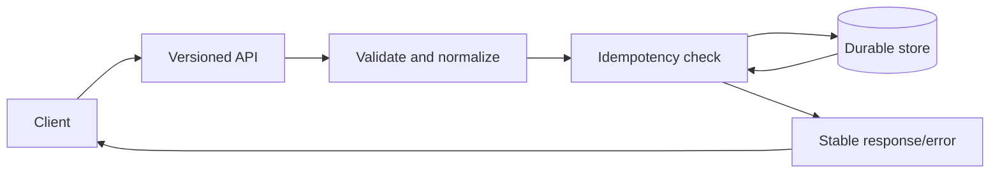
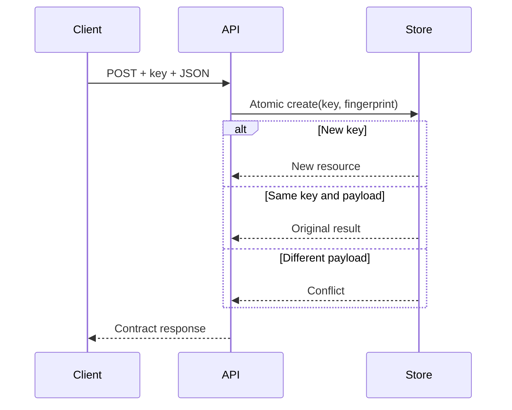
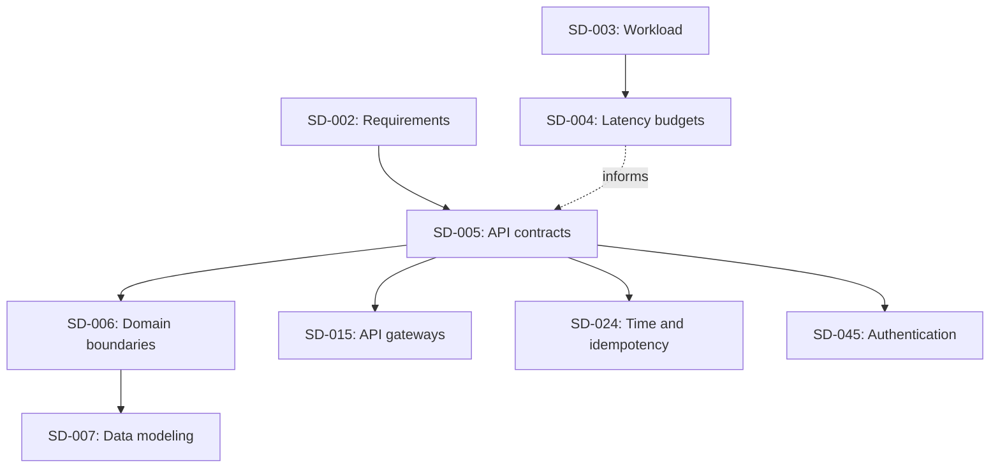

# DAY 5: API Design, Contracts, and Versioning

**Progression level:** Level 1, Foundations and architectural reasoning  
**Concept ID:** SD-005  
**Prerequisites:** SD-002, Requirements discovery and specification, covered  
**Status:** Lesson delivered; exercises pending.

### 1. Why It Exists

An API is a compatibility boundary between independently deployed clients and servers. A handler can return success while violating its contract through duplicate writes after retries, unstable errors, undocumented defaults, or pagination that skips records during concurrent inserts. Once multiple clients depend on an API, changing behavior becomes a distributed migration rather than a local code change.

A contract defines resource identity, request/response schemas, validation, status codes, idempotency, pagination, limits, and evolution policy. It hides implementation details while making client-visible behavior predictable.

### 2. Core Idea

An API contract covers:
- **Semantics:** what each operation does and which invariants hold.
- **Representation:** field types, nullability, defaults, units, and timestamps.
- **Failures:** stable error codes, HTTP status, retryability, and ambiguous outcomes.
- **Concurrency:** idempotency, conditional writes, conflict behavior, and ordering.
- **Collections:** sorting, page limits, cursor semantics, and snapshot guarantees.
- **Evolution:** additive changes, breaking changes, deprecation, and version retirement.

HTTP status codes express broad outcomes. Clients should branch on stable codes such as `idempotency_key_reused`, not human-readable messages.

**Idempotency** means repeating an operation with the same identity and equivalent payload does not repeat its business effect. It does not guarantee exactly-once delivery. A timeout does not prove that a write failed. A retry with the same key should recover the original result; reusing the key with a different payload should conflict.

**Pagination** defines collection traversal. Offset pagination is simple but can be expensive and unstable under writes. Keyset pagination resumes after a deterministic ordered key. A cursor is not automatically a snapshot. Snapshot-consistent exports require a snapshot boundary.

**Versioning** is a compatibility strategy. Path versioning such as `/v1/documents` is explicit. Optional response fields may be compatible if clients tolerate unknown fields. New required request fields, changed field meanings, defaults, ordering, or accepted values may be breaking even if JSON still parses.

### 3. Mental Model

Treat an API as a protocol between independently changing state machines. Clients cannot inspect server state, so every ambiguous outcome needs a documented recovery path.

For a create operation, validate and normalize the request, fingerprint its semantic payload, and atomically associate the idempotency key with the business result. A retry after a lost response returns the original resource. A process-local mutex provides this guarantee only within one process. Production requires durable shared state, usually a uniqueness constraint and transaction covering both the mutation and idempotency record. External side effects may require an outbox or durable workflow.

A base64 cursor is opaque by convention, not confidential or tamper-proof. Authorization must be checked independently.

### 4. Real-World Example

A document service is used by a web app and an asynchronous ingestion worker. The worker may retry after a timeout; the web app traverses a changing list.

**Documented facts:** HTTP semantics and status codes are specified by RFC 9110, JSON syntax by RFC 8259, and Go's HTTP/JSON APIs by the standard library.
- https://www.rfc-editor.org/rfc/rfc9110
- https://www.rfc-editor.org/rfc/rfc8259
- https://pkg.go.dev/net/http
- https://pkg.go.dev/encoding/json

**Established industry practice:** validate at the boundary, use stable error codes, cap request sizes, document retry semantics, use deterministic ordering, and test compatibility.

**Engineering inference for this hypothetical service:** create requires `Idempotency-Key`; the first success returns 201 and `Location`; a replay returns the same resource and `Idempotency-Replayed: true`; a different payload for the same key returns 409. The list uses an immutable creation sequence. Later-created records may appear on later pages, so this is not a snapshot export.

### 5. Low-Level Design (LLD)

| Operation | Success | Important failures |
|---|---|---|
| `POST /v1/documents` with JSON and `Idempotency-Key` | 201, document, `Location` | 400 invalid input, 409 key conflict, 413 oversized body, 415 wrong media type |
| `GET /v1/documents/{id}` | 200, document | 404 absent resource |
| `GET /v1/documents?limit=N&cursor=T` | 200, items and optional cursor | 400 invalid query |

Contract rules: title is trimmed, required, and at most 200 Unicode code points. Content must be non-whitespace and at most 900 KiB. Body limit is 1 MiB. Page size defaults to 50 and ranges from 1 to 100. Unknown JSON fields and trailing JSON values are rejected. Error bodies use `{"error":{"code":"...","message":"..."}}`; clients depend on `code`.

The in-memory store maintains an ID sequence, resource map, and idempotency-key map. A mutex protects key lookup and document creation as one critical section.

Invariants: a key maps to one fingerprint/result; same key and payload replay the result; a different payload conflicts without creating a document; generated IDs are unique. This is atomic only inside one process. Production storage must enforce the same invariants transactionally.

### 6. High-Level Design (HLD)



Create flow: route by version and method, validate content type/key/body/schema, normalize and fingerprint, atomically create or replay, then return documented status and headers. For list APIs, validate query parameters, bound page size, validate cursor, fetch `limit + 1`, and return a next cursor only when another page exists.



With multiple replicas, idempotency must use shared durable state. If the write also publishes an event, use a transactional outbox or durable workflow to avoid a database/message dual-write gap.

### 7. Realistic Go Code

This standard-library example implements a versioned create endpoint with strict JSON parsing, bounded bodies, stable errors, idempotent replay, and server timeouts. The store is process-local for demonstration, not production durability.

```go
package main

import (
	"crypto/sha256"
	"encoding/json"
	"errors"
	"fmt"
	"io"
	"log"
	"mime"
	"net/http"
	"strings"
	"sync"
	"time"
	"unicode/utf8"
)

type request struct {
	Title string ` + "`json:\"title\"`" + `
	Content string ` + "`json:\"content\"`" + `
}
type document struct {
	ID string ` + "`json:\"id\"`" + `
	Title string ` + "`json:\"title\"`" + `
	Content string ` + "`json:\"content\"`" + `
	CreatedAt time.Time ` + "`json:\"created_at\"`" + `
}
type record struct { hash [32]byte; doc document }
type store struct {
	mu sync.Mutex
	next uint64
	docs map[string]document
	keys map[string]record
}
func newStore() *store { return &store{docs: map[string]document{}, keys: map[string]record{}} }

func (s *store) create(key string, hash [32]byte, in request) (document, bool, error) {
	s.mu.Lock()
	defer s.mu.Unlock()
	if old, ok := s.keys[key]; ok {
		if old.hash != hash { return document{}, false, errors.New("key conflict") }
		return old.doc, true, nil
	}
	s.next++
	d := document{ID: fmt.Sprintf("doc_%06d", s.next), Title: in.Title, Content: in.Content, CreatedAt: time.Now().UTC()}
	s.docs[d.ID] = d
	s.keys[key] = record{hash: hash, doc: d}
	return d, false, nil
}

type api struct { store *store }
type apiError struct {
	Code string ` + "`json:\"code\"`" + `
	Message string ` + "`json:\"message\"`" + `
}
func writeJSON(w http.ResponseWriter, status int, v any) {
	w.Header().Set("Content-Type", "application/json; charset=utf-8")
	w.WriteHeader(status)
	if err := json.NewEncoder(w).Encode(v); err != nil { log.Printf("encode response: %v", err) }
}
func fail(w http.ResponseWriter, status int, code, msg string) {
	writeJSON(w, status, map[string]apiError{"error": {Code: code, Message: msg}})
}
func (a *api) ServeHTTP(w http.ResponseWriter, r *http.Request) {
	if r.URL.Path != "/v1/documents" || r.Method != http.MethodPost {
		fail(w, 404, "not_found", "route not found")
		return
	}
	key := r.Header.Get("Idempotency-Key")
	if len(key) < 1 || len(key) > 128 || strings.TrimSpace(key) != key {
		fail(w, 400, "invalid_idempotency_key", "Idempotency-Key is required and limited to 128 bytes")
		return
	}
	media, _, err := mime.ParseMediaType(r.Header.Get("Content-Type"))
	if err != nil || media != "application/json" {
		fail(w, 415, "unsupported_media_type", "Content-Type must be application/json")
		return
	}
	r.Body = http.MaxBytesReader(w, r.Body, 1<<20)
	defer r.Body.Close()
	dec := json.NewDecoder(r.Body)
	dec.DisallowUnknownFields()
	var in request
	if err := dec.Decode(&in); err != nil {
		var maxErr *http.MaxBytesError
		if errors.As(err, &maxErr) { fail(w, 413, "body_too_large", "body exceeds 1 MiB"); return }
		fail(w, 400, "invalid_json", "expected one valid JSON object")
		return
	}
	var trailing any
	if err := dec.Decode(&trailing); !errors.Is(err, io.EOF) {
		fail(w, 400, "invalid_json", "expected exactly one JSON value")
		return
	}
	in.Title = strings.TrimSpace(in.Title)
	if in.Title == "" || utf8.RuneCountInString(in.Title) > 200 || strings.TrimSpace(in.Content) == "" || len(in.Content) > 900<<10 {
		fail(w, 400, "invalid_request", "title or content violates documented limits")
		return
	}
	canonical, err := json.Marshal(in)
	if err != nil { fail(w, 500, "internal_error", "request could not be processed"); return }
	hash := sha256.Sum256(canonical)
	d, replay, err := a.store.create(key, hash, in)
	if err != nil { fail(w, 409, "idempotency_key_reused", "key was used with a different payload"); return }
	w.Header().Set("Location", "/v1/documents/"+d.ID)
	w.Header().Set("Cache-Control", "no-store")
	if replay { w.Header().Set("Idempotency-Replayed", "true") }
	writeJSON(w, 201, d)
}
func main() {
	srv := &http.Server{Addr: ":8080", Handler: &api{store: newStore()}, ReadHeaderTimeout: 5*time.Second, ReadTimeout: 15*time.Second, WriteTimeout: 15*time.Second, IdleTimeout: 60*time.Second}
	log.Fatal(srv.ListenAndServe())
}
```

The compact example omits direct reads and list handlers to keep implementation focus on retry semantics. Production also needs graceful shutdown, authentication, rate limits, durable storage, request IDs, and storage-error classification. It should not map every storage failure to 409 as this demonstration does.

### 8. Example Usage

Run `go run main.go` and send:

```sh
curl -i -X POST http://localhost:8080/v1/documents -H 'Content-Type: application/json' -H 'Idempotency-Key: ingest-781' -d '{"title":"Runbook","content":"Recovery procedure"}'
```

The first call returns 201, `Location`, and the document. Repeating the same payload with the same key returns the same ID and `Idempotency-Replayed: true`. Reusing the key with different content returns 409 and code `idempotency_key_reused`.

A contract test should assert status and replay behavior. Add tests for malformed JSON, unknown fields, oversized bodies, missing keys, concurrent same-key requests, and compatibility. Run `go test ./...` and `go test -race ./...` in a Go module.

### 9. Production Considerations

- **Durability:** store key scope, fingerprint, result reference, and expiry in shared storage. Commit the business mutation and key record atomically with a uniqueness constraint.
- **Scope/retention:** define tenant or principal scope and retention. Too-short retention permits late duplicates; indefinite retention grows without bound.
- **Ambiguous outcomes:** retry with the same key. If a provider outcome is unknown, expose a durable pending state and reconciliation path.
- **Fingerprinting:** normalize only semantically equivalent fields and preserve canonicalization for the key-retention window.
- **Pagination:** use deterministic indexed ordering with a unique tie-breaker. Define whether new records may appear on later pages and whether snapshot consistency is promised.
- **Limits:** bound body size, page size, headers, request duration, and concurrent work. Apply quotas where identity is available.
- **Compatibility:** do not silently change field meaning, units, defaults, ordering, or error semantics. Test old clients and classify changes as breaking or compatible.
- **Security:** authorize every operation and enforce tenant predicates in storage. Cursors and idempotency keys are not authorization. Do not log sensitive bodies or raw keys.
- **Observability:** record route template, status, stable error code, latency, and replay count. Avoid high-cardinality labels.
- **Timeouts:** configure header/read/write timeouts and propagate contexts to downstream calls. Cancellation does not roll back a committed write.
- **Deployment:** publish deprecation dates, monitor old-version use, deploy compatible schema changes safely, and retain rollback paths.
- **Contract tests:** verify statuses, headers, schemas, errors, retries, pagination, authorization, and old-client behavior.

### 10. Tradeoffs

| Choice | Benefit | Limitation |
|---|---|---|
| Path versioning | Explicit routing | Multiple versions increase maintenance |
| Additive evolution | Avoids version proliferation | Requires tolerant clients |
| Offset pagination | Simple, arbitrary page jumps | Deep scans and unstable positions |
| Cursor pagination | Efficient continuation | More complex cursor/snapshot semantics |
| Idempotency key | Recovers ambiguous writes | Durable state and retention policy |
| Strict request validation | Rejects typos | May reject unknown client fields |
| In-memory key store | Fast local tests | Lost on restart, inconsistent across replicas |

Do not create a major version for every optional field, and do not assume additive JSON syntax guarantees semantic compatibility.

### 11. Connection to Previous Lessons

Day 1 established constraint-driven reasoning. Day 2 defined requirements and acceptance criteria. Day 3 modeled workload and resource demand. Day 4 allocated latency across a request path. SD-005 turns these requirements into a stable protocol.

SD-005 depends on SD-002, which is covered. SD-003 informs limits; SD-004 informs timeout and response objectives. These are relationships, not extra formal prerequisites. Prior exercises remain pending unless submitted and reviewed.

### 12. What Comes Next

**SD-006: Domain Boundaries and Data Ownership**, Level 1. With requirements and API semantics defined, the next question is which domain owns each resource and invariant, which component is authoritative, and where transaction boundaries belong. SD-015, API gateways, also becomes eligible, but SD-006 is earlier in curriculum order. It is not taught here.

### 13. Mini Exercise

Design `POST /v1/payments` for a client that may time out after a provider accepted the charge. Define key scope/retention, same-key/same-payload and conflicting-payload behavior, errors for validation/funds/provider timeout/duplicate, behavior for unknown provider outcome, and safe retry plus final-state retrieval.

**Acceptance criteria:** Include request/success schemas, four error examples, a state-transition table, and explicit treatment of the ambiguous provider outcome. Do not claim exactly-once execution merely because a key exists.

### Key Takeaways

- An API is a protocol and compatibility boundary, not just a handler.
- Specify semantics, schemas, errors, retries, ordering, pagination, limits, and version policy.
- A timeout creates an ambiguous outcome; durable idempotency can recover the original result.
- Keyset pagination does not automatically provide snapshot consistency.
- Compatibility includes semantics, not just schema syntax.
- Process-local synchronization is not distributed durability.
- Test observable behavior, including failures.

### Concept Map



### Exercise

Build an API contract and compatibility suite for a multi-tenant document service.

**Deliverables:** an OpenAPI spec for create/read/list; a policy classifying ten proposed changes; durable idempotency design; cursor semantics and snapshot guarantees; tests for malformed/oversized requests, auth failures, duplicate/conflicting keys, concurrent retries, concurrent inserts, and old clients; failure analysis for disconnect-after-commit, restart, multi-replica retries, and key expiry; rollout/deprecation/rollback plan.

**Acceptance criteria:** specification and implementation agree on statuses, headers, and fields. Concurrent retries cannot duplicate effects within the documented scope. Tests prove pagination guarantees. Breaking changes have migration plans. Sensitive payloads and raw keys are not logged. Pending until submitted and reviewed.

### Progress

- **Day:** 5, based on verified Day 1 through Day 4 lesson history.
- **Level:** Level 1, Foundations and architectural reasoning.
- **Concept:** SD-005, API design, contracts, and versioning.
- **Lesson path:** `system-design/lessons/day-05-api-design-contracts-and-versioning.md`
- **Prerequisites:** SD-002 covered.
- **Exercises:** Mini and substantial exercises pending; no learner submission reviewed.
- **Covered concepts:** SD-001 through SD-005.
- **Next concept:** SD-006, Domain Boundaries and Data Ownership. SD-015 is also eligible.
- **Repository update:** Reconcile stale SD-004 status and verify lesson and trackers after persistence.

### Most Important Mental Model

**A good API contract makes retries, failures, and evolution predictable for clients that cannot see the server's internal state.**
